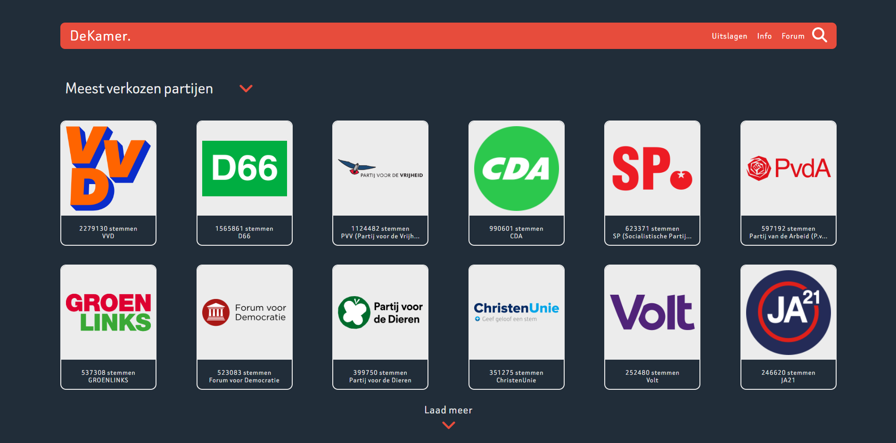

# DeKamer.

A European Union funded website aiming to help the Dutch people understand the election results with interactive 
infographics and a forum to chat about these results. Involving the people in the democratic process in order to 
strengthen the people's trust in the democracy.

## Table of contents

- [Introduction](docs/project-docs/technical-documentation/introduction.md)
- [Data processing](docs/project-docs/technical-documentation/data-processing.md)
- [API documentation](docs/project-docs/technical-documentation/api-documentation.md)
- [Security](docs/project-docs/technical-documentation/security.md)
- [Architecture overview](docs/project-docs/technical-documentation/architecture.md)
- [Installation guide](docs/project-docs/technical-documentation/installation-guide.md)
- [Deployment](docs/project-docs/technical-documentation/deployment.md)
- [Logging and monitoring](docs/project-docs/technical-documentation/logging.md)
- [Troubleshooting](docs/project-docs/technical-documentation/troubleshooting.md)