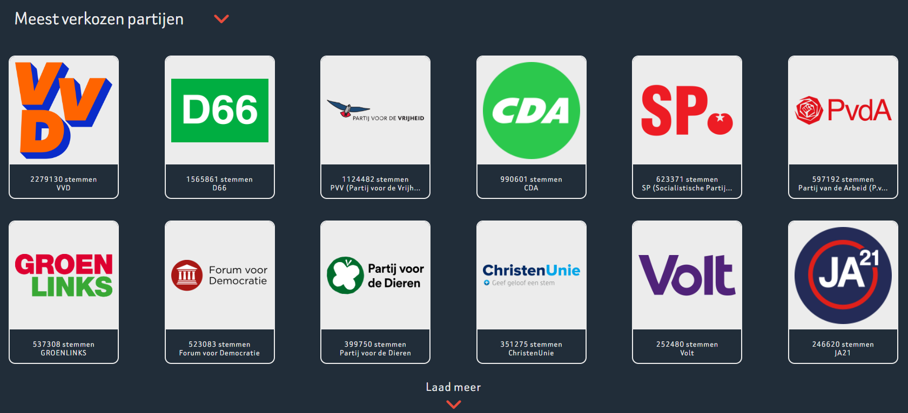
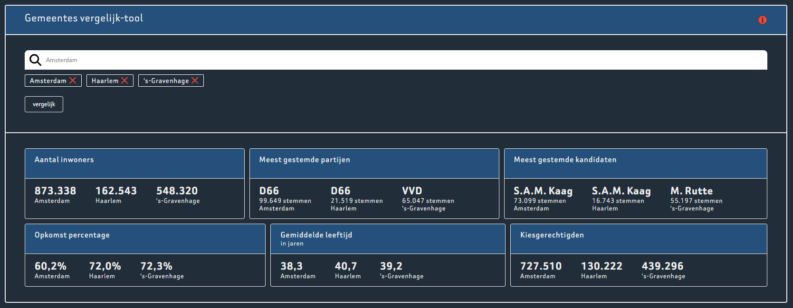
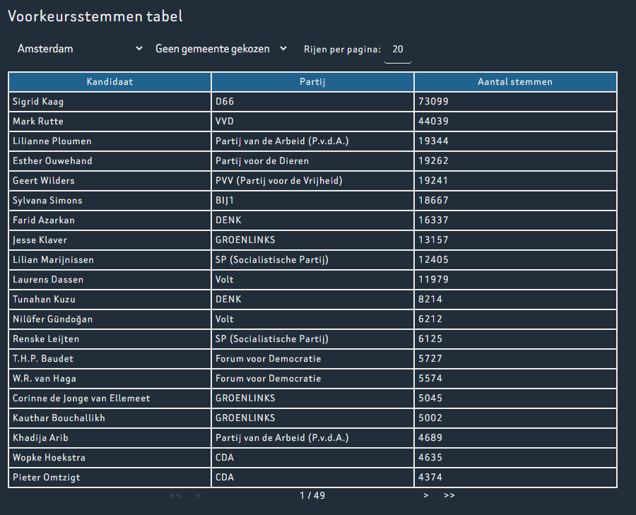
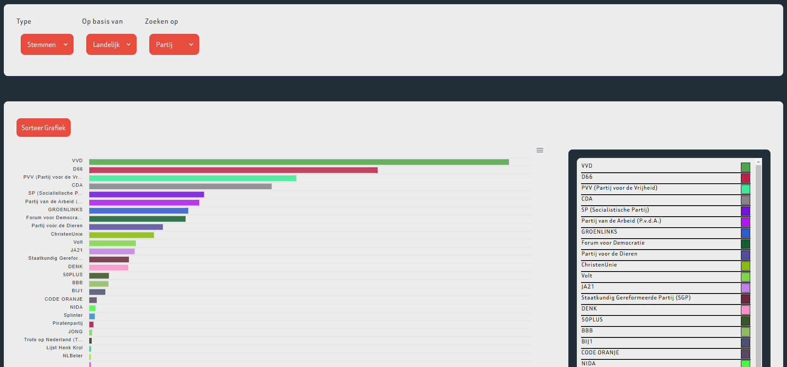
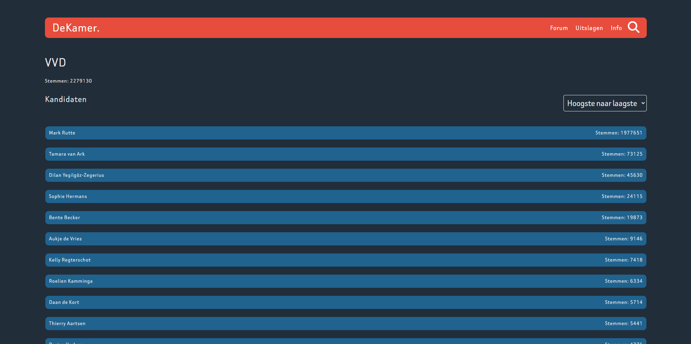
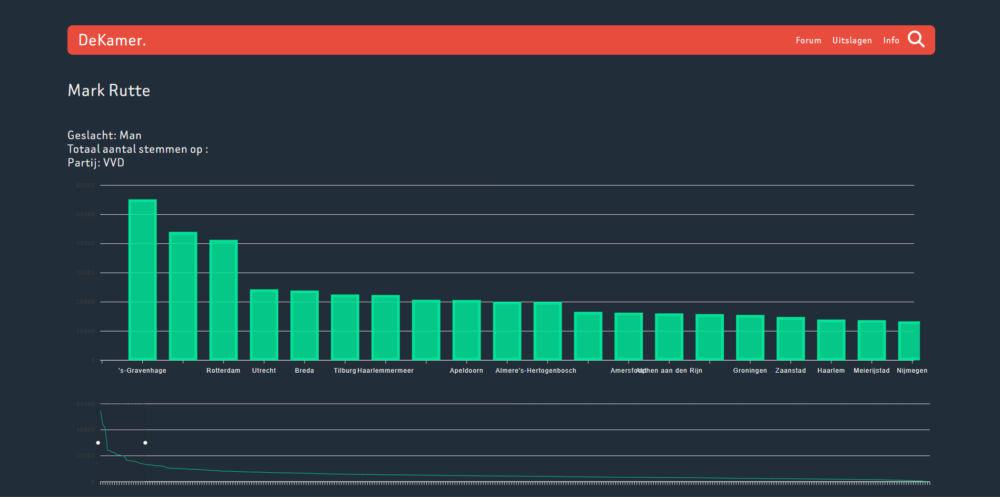
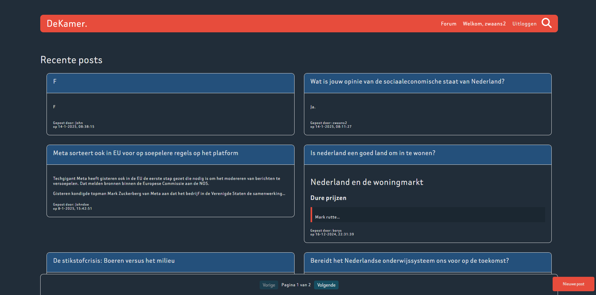
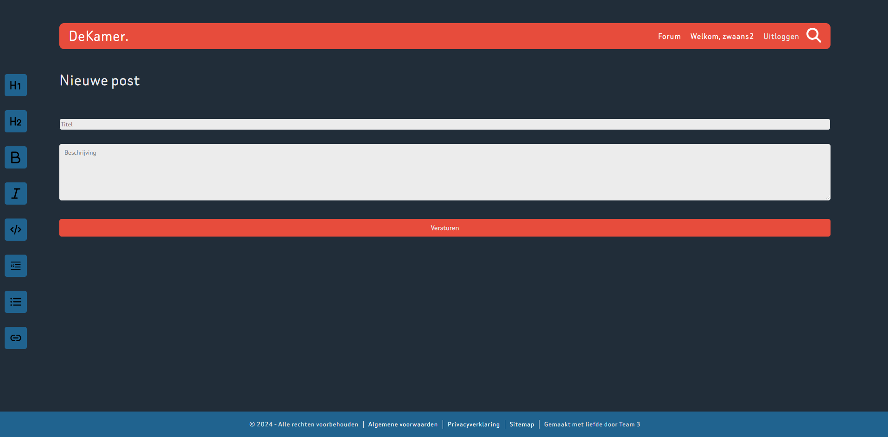

## Introduction

This application contains both the frontend and the backend for the European Union funded election results website 
DeKamer. The purpose of this website is to help the Dutch people understand the election results with interactive 
infographics alongside a forum to chat about these results. With this we hope to involve the people in the democratic 
process and strengthen their trust in the democratic process. 

### Target audience
The website is targeted towards young adults, as this group has a relatively low voter turnout during the elections. By 
helping them understand the elections we hope to encourage them to vote in the future elections.

### Key features
- A quick overview of the election results on the homepage, immediately showing the 
 user the most voted parties. The user can also choose to switch the overview to the parties with the least votes, or 
 the candidates with most or least votes:

- A results page with several infographics for the user to view data, such as:
  - A tool with which the user can compare municipalities, showing both election and population data of the selected 
   municipalities:
   
  - A table which allows the user to select a constituency, municipality or polling station to show all the candidates' 
   votes in:
   
  - A customizable chart with several options of what to show. It can display the number of candidates in each party 
    or votes on country, constituency or municipality level for specific parties or the members of a party. Using 
    the legend you can (de)select parties or candidates. It also allows the user to download the chart as SVG, PNG 
    OR CSV.
   
- The user can access a party details page when clicking on a party on the homepage, here they can see a list of all 
  candidates with their total votes.
  
- The user can access a candidate details page by searching for a candidate in the search bar or selecting one from 
  the homepage or party details page. Here they can see the gender, total votes and party of the candidate along 
  with a chart displaying the candidate's votes in all municipalities
  
- Finally, on the forum the user can view posts made by other users or create posts of their own after registering 
  to the website.
  
  
  
[Next page: data processing](data-processing.md) | [Back to title page](/README.md)