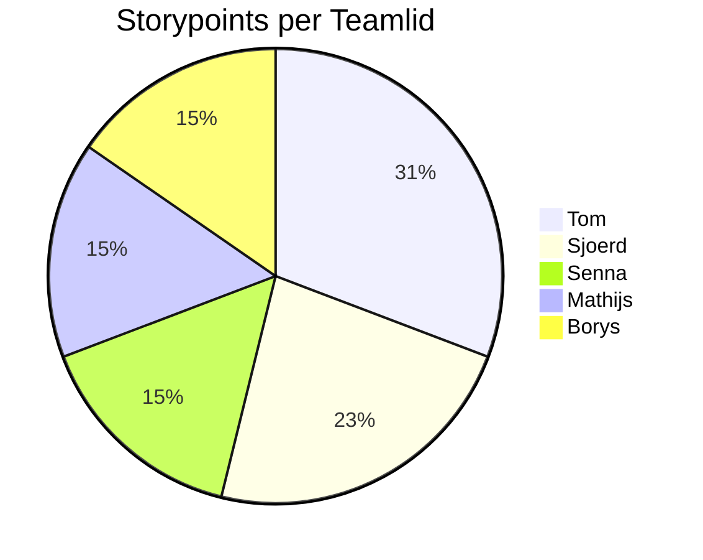

# Sprint 2

## Retrospective

Wij hebben gebruik gemaakt van de well, not so well, new ideas retrospective.
Ook hebben we feedback voor elk teamlid individuele  opgeschreven.

### Well

- Presentatie ging geweldig.
- We hebben een goed scrumboard.
- Data is op de website.
- Overal goed bezig geweest.

### Not so well

- We konden wat eerder beginnen met het creeëren van belangrijke features inplaats van alles op het laatste moment.

### New Ideas

- Starten met het beter/meer aangeven waar we mee bezig zijn door wellicht een daily stand-up.
- Starten met betere communicatie tijdens het coderen. Welke feature is nu belangrijk? Waar ben je deze week mee bezig? Waar moeten we opletten? etc.

## Story points

## Feedback voor teamleden

### Borys

#### Tips

- Raak de backend aan

#### Tops

- Naar aanleiding van de feedback van de vorige sprint, is hij nu veel meer op tijd.

### Senna

#### Tips

- Vorige versies van XMLreader en of andere scripts ook uploaden: we hebben nu alleen de tweede en laatste versie

#### Tops

- Chart is mooi gemaakt

### Sjoerd

#### Tips

- UX technieken toepassen

#### Tops

- Nice class diagrams

### Mathijs

#### Tips

n.v.t.

#### Tops

- Searchbar is, en ik quote: "Ziek"

### Tom

#### Tips

n.v.t.

#### Tops

- Leiderschap
- Veel kennis over alles
- Weet constant waar iedereen mee bezig is