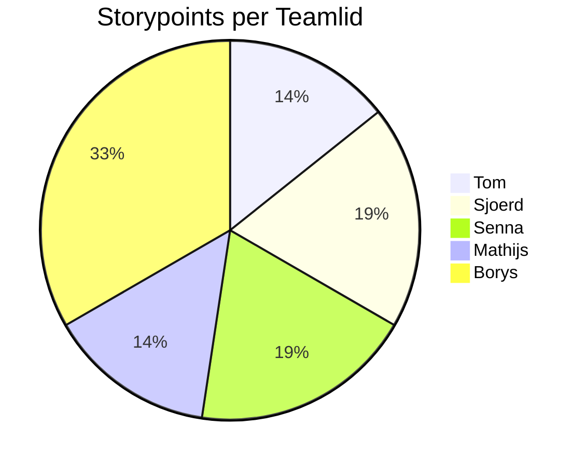

# Sprint 4

## Retrospective

Voor sprint 4 maken we gebruik van de well, not so well, new ideas methode om zo een beter inzicht te krijgen waar we ons op persoonlijk vlak kunnen verbeteren.

### Well
- Grote verbetering op het maken en bijhouden van issues op het issueboard.
- Het werken met Feature branches integreren ging goed deze sprint.
- Aanwezigheid en communicatie is uitmuntend deze sprint.
- We liggen goed op schema met het project.

### Not so well
- Het op tijd mergen van feature branches met dev en daarna main.
- Het voorbereiden van de presentatie voor de sprint review.
- Betere inschatting van het aantal werk dat gedaan moet worden.

### New Ideas
- Het integreren van sprint poker in onze dagelijkse routine.
- Het beter gebruik maken van Daily standups en dit ook buiten schooluren via discord gaan doen.
- Het deployen van de applicatie op een domein.

## Story points

## Feedback voor teamleden

### Borys

#### Tips
- N.v.t

#### Tops
- Goede feature voor het inladen van de politieke afbeeldingen op de landingspagina.
- Goed dat je met  externe API's werkt.

### Senna

#### Tips
- Minder snel praten tijdens het presenteren van het product.

#### Tops

- Goede motivatie voor het onderhouden en maken van de chart met apex charts.
- Als je iets niet begrijpt ga je door tot dat je het wel begrijpt.

### Sjoerd

#### Tips
-  Gebruikersvriendelijkere visuals voor je table voor volgende sprint.

#### Tops

- Goed dat je nadenkt over de ethische aspecten van het project.
- Fijn dat de table snel en efficient werkt.

### Mathijs

#### Tips
- Als je gebruikt maakt van een DTO blijf er dan consistent mee. Een ander voorbeeld is het consistent gebruik maken van dezelfde library voor charts.

#### Tops

- Goed bezig geweest met Vue.

### Tom

#### Tips
- optijd je feature uploaden.

#### Tops
- Vue progressie gemaakt.
- Altijd aanwezig ongeacht uitvallende treinen.
