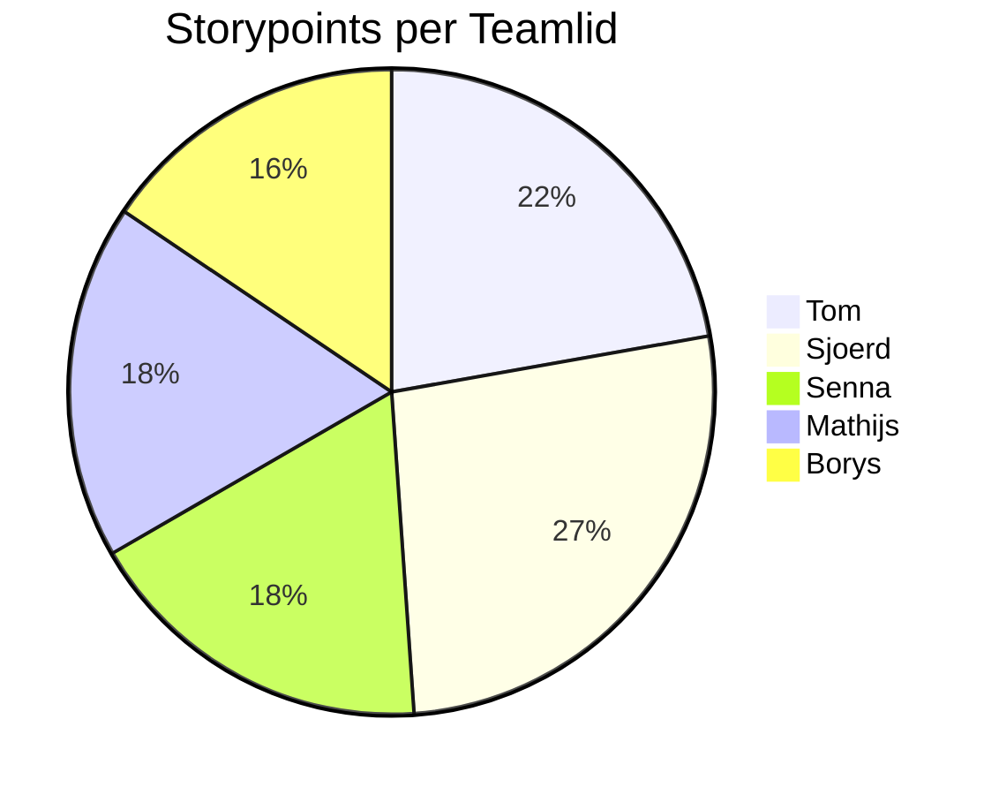

# Sprint 5

## Retrospective

Voor sprint 5 maken we gebruik van de well, not so well, new ideas methode om zo een beter inzicht te krijgen waar we ons op persoonlijk vlak kunnen verbeteren.

### Well

- Heel veel user stories afgemaakt
- Gedeployde versie die werkt
- Communicatie ging goed
- Alles op tijd af en ruim van tevoren gedployd
- We waren we allemaal aanwezig

### Not so well

- Komen nog weleens console logs door de merge requests heen
- Productiviteit in de les kan nog wel wat omhoog

### New Ideas

- Iets meer interageren met de merge requests, meer context geven bij de merge request

## Story points

De story points zijn redelijk goed verdeeld. Borys heeft iets minder story points, maar dit
is mede dankzij zijn verhuizing en de tijd die hij daaraan heeft besteed. 

PS De story points zijn niet helemaal correct, twee user stories met beide weight 1
kunnen verschillende moeilijkheidsgraden hebben. Hierdoor zit er wat verschil in de 
story points per teamlid. Wij zijn zelf van mening dat ieder teamlid ongeveer
evenveel werk heeft verricht.

## Feedback voor teamleden

### Borys

#### Tips

- Komt af en toe wat bot over ivm team communicatie. 
- Blijf positief en constructief.
- Voor volgende sprint wat meer story points pakken.

#### Tops

- Veel werk verricht ondanks verhuizing.
- Als teamlid ben je erg betrokken.

### Senna

#### Tips

- Scrum board beter bijhouden
- Let op spelling en taal

#### Tops

- Goede motivatie voor het onderhouden en maken van de chart met apex charts.
- Als je iets niet begrijpt, ga je door tot dat je het wel begrijpt.

### Sjoerd

#### Tips

- Komt af en toe wat bot over
- Probeer de feedback uit vorige feedback momenten wat gedetailleerder op te volgen

#### Tops

- Altijd op tijd aanwezig
- Lekker radicaal met het verwijderen van onnodige code

### Mathijs

#### Tips

- Check regulaties van data handling
- Iets meer richten op de UX, verplaats je in de gebruiker

#### Tops

- Goed dat je jwt werkend hebt gekregen
- Veel functionaliteit geleverd

### Tom

#### Tips

- Probeer wat meer te communiceren over wat je aan het doen bent
- Bij wat ingewikkeldere code, betrek de rest van het team erbij

#### Tops

- Lekker bezig met deployen
- Altijd erg behulpzaam