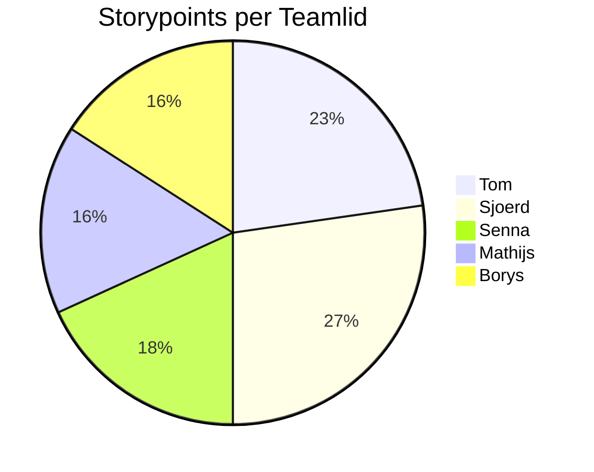

# Sprint 4

## Retrospective

Voor sprint 5 maken we gebruik van de well, not so well, new ideas methode om zo een beter inzicht te krijgen waar we ons op persoonlijk vlak kunnen verbeteren.

### Well

- Heel veel user stories afgemaakt
- Gedeployde versie die werkt
- Communicatie ging goed
- Alles op tijd af en ruim van tevoren gedployd
- We waren we allemaal aanwezig

### Not so well

- Komen nog weleens console logs door de merge requests heen
- Productiviteit in de les kan nog wel wat omhoog

### New Ideas

- Iets meer interageren met de merge requests, meer context geven bij de merge request

## Story points

## Feedback voor teamleden

### Borys

#### Tips

- Komt af en toe wat bot over

#### Tops

- Veel werk verricht ondanks verhuizing

### Senna

#### Tips

- Scrum board beter bijhouden
- Let op spelling en taal

#### Tops

- Goede motivatie voor het onderhouden en maken van de chart met apex charts.
- Als je iets niet begrijpt ga je door tot dat je het wel begrijpt.

### Sjoerd

#### Tips

- Komt af en toe wat bot over

#### Tops

- Altijd op tijd aanwezig

### Mathijs

#### Tips

- Check regulaties van data handling
- Iets meer richten op de UX, verplaats je in de gebruiker

#### Tops

- Goed dat je jwt werkend hebt gekregen

### Tom

#### Tips

- n.v.t.

#### Tops

- Lekker bezig met deployen