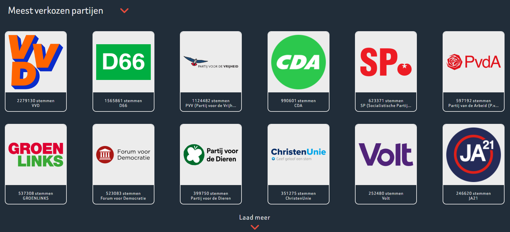
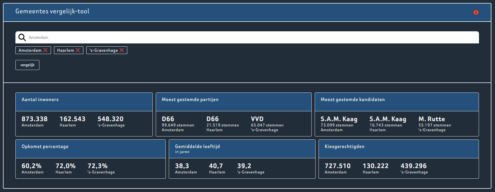
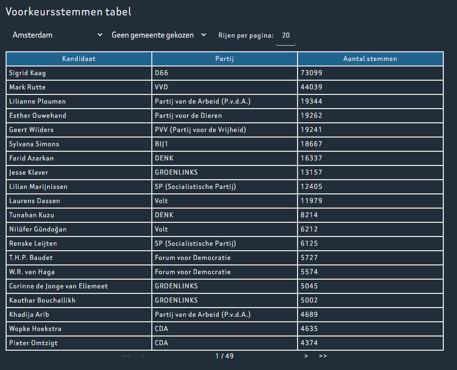

# Introduction

This application contains both the frontend and the backend for the European Union funded election results website 
DeKamer. The purpose of this website is to help the Dutch people understand the election results with interactive 
infographics alongside a forum to chat about these results. With this we hope to involve the people in the democratic 
process and strengthen their trust in the democratic process. 

### Target audience
The website is targeted towards young adults, as this group has a relatively low voter turnout during the elections. By 
helping them understand the elections we hope to encourage them to vote in the future elections.

### Key features
- A quick overview of the election results on the homepage, immediately showing the 
user the most voted parties. The user can also choose to switch the overview to the parties with the least votes, or 
the candidates with most or least votes:

- A results page with several infographics for the user to view data, such as:
  - A tool with which the user can compare municipalities, showing both election and population data of the selected 
  municipalities:
  
  - A table which allows the user to select a constituency, municipality or polling station to show all the candidates' 
  votes in:
  
  - A chart
- Party details page
- Candidate details page
- Forum